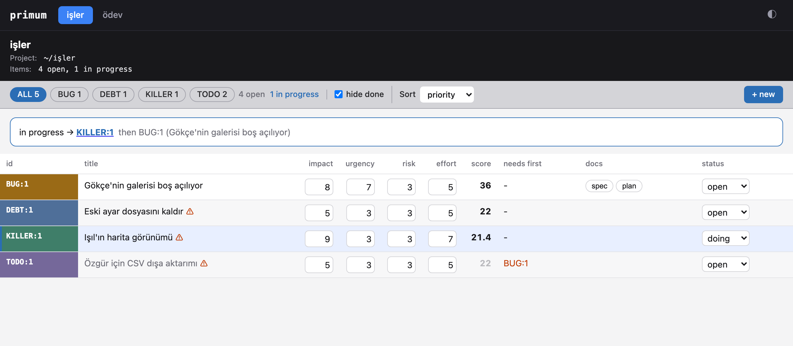

# primum

Prioritized work items for any number of projects, kept as plain markdown
files, with a command line and a local web board.

<picture>
  <source media="(prefers-color-scheme: dark)" srcset="docs/board-dark.png">
  
</picture>

## Install

```bash
brew install erhangundogan/tap/primum
```

or with the install script, which verifies the download's checksum:

```bash
curl -fsSL https://raw.githubusercontent.com/erhangundogan/primum/main/install.sh | sh
```

or, with a Rust toolchain:

```bash
cargo install primum --locked
```

## Quick start

```bash
cd ~/projects/my-app
primum init                                  # primum.toml and an empty items/
primum add TODO "Export to CSV" --body-file why.md
primum list                                  # open items, highest priority first
primum next                                  # what to work on now
primum serve                                 # the board in your browser
```

## Items are files

Each item is one markdown file in `items/`, named for its id
(`items/TODO-87.md` is `TODO:87`):

```markdown
---
title: "Adoption metrics: daily snapshot job and a Metrics page"
status: doing
impact: 7
urgency: 6
risk: 2
effort: 4
needs: [TODO:64]
---

The item's text, as markdown.
```

Kinds are lanes, in this order: `URGENT`, `BUG`, `DEBT`, `KILLER`, `TODO`.
Statuses are `open`, `doing`, `done` and `wontfix`. Scores run from 1 to 10;
an item's priority is `(impact + urgency + risk) * 10 / effort`, and items
are ordered by lane, then priority. An item whose `needs` name an open item
is blocked.

Edit the files with primum, the board, or any text editor. Every change
rewrites `BOARD.md`, a read-only summary of the whole project.

## Documents beside items

An item's documents sit next to it: `items/TODO-87.spec.md`,
`items/TODO-87.plan.md`, any `items/<ID>.<type>.md`. The board shows them
as tabs beside the item's text. An item can also show another item's
document by listing it: `docs: [items/TODO-80.spec.md]`.

```bash
primum doc TODO:87 spec --file spec.md
```

## Many projects

Each project describes itself in its `primum.toml`. Your machine's list of
projects, in tab order, is `~/.config/primum/projects.toml`:

```toml
projects = ["~/projects/my-app", "~/projects/my-lib"]
```

`primum projects` lists them, `primum projects add PATH` and
`primum projects remove NAME` edit the list. The board shows one tab per
project. On the command line, `-p NAME` picks a project; without it primum
uses the project you are in, else the only one listed.

## License

Apache-2.0
